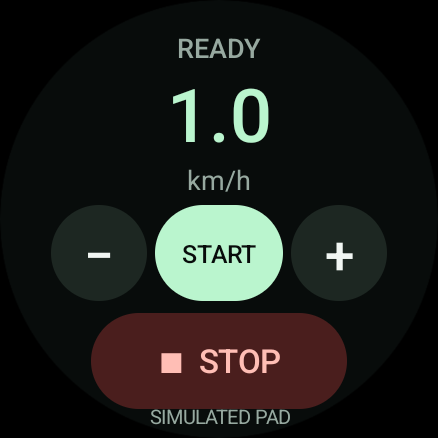
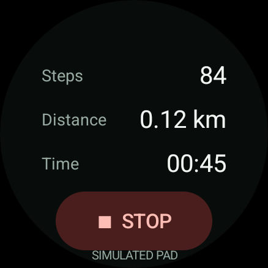
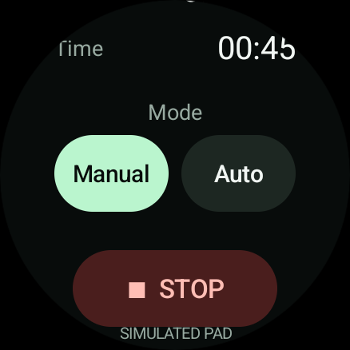

<p align="center"></p>

# Stride Remote

Control a WalkingPad from a Wear OS watch, without a phone or the physical remote.

[Download the latest APK](https://github.com/Kahtaf/stride-remote/releases/latest) · [Install](INSTALL.md) · [Contribute](CONTRIBUTING.md)

**Status:** experimental, first public release. Initial hardware testing uses a Samsung Galaxy Watch8 and KingSmith WalkingPad A1 Pro (WPA1F Pro). Live speed, Start and Stop have been exercised on that setup; broader model compatibility and the new mode/session UI still need community hardware testing. Simulated-pad tests are not proof of compatibility with another treadmill.

## Controls

- Start with a second-tap confirmation.
- Change speed in 0.1 km/h steps, within 0.5–6.0 km/h.
- Stop stays visible while scrolling and is also available in the connection notification.
- Read the pad's session steps, distance and elapsed time.
- Select Manual or Auto while stopped; the selection follows confirmed pad telemetry.
- Return through the persistent notification or Wear OS ongoing-activity shortcut.

The watch connects directly over Bluetooth LE. No companion APK, account, cloud service, analytics or Internet permission. The app remembers one pad locally.

<p>
  
  
  
</p>

*Screenshots use a simulated pad on a round Wear OS emulator. The simulation label appears only in debug builds.*

## Compatibility

| Component | Requirement / known result |
| --- | --- |
| Watch | Wear OS on Android API 33+ (Wear OS 4+), with Bluetooth LE |
| Tested watch | Samsung Galaxy Watch8 |
| Tested pad | WalkingPad A1 Pro, model WPA1F Pro |
| Protocol | Classic FE00 service, FE01 notifications, FE02 writes |
| Other pads | Unverified; the same brand or a 2.4 GHz remote does not establish compatibility |

The app supports the classic Bluetooth protocol. It cannot transmit a proprietary 2.4 GHz remote signal and does not support every WalkingPad model or newer protocol. See [protocol and attribution](docs/PROTOCOL.md).

## Install and use

Download `stride-remote-<version>.apk` from [Releases](https://github.com/Kahtaf/stride-remote/releases/latest) and sideload it onto the **watch**. [INSTALL.md](INSTALL.md) covers wireless ADB, pairing, and a small-chunk fallback for unreliable transfers.

Close other pad controllers, then choose **Find pad**, grant Nearby devices and notifications, and select your pad. A stopped pad is prepared in Manual mode without sending Start. Tap **Start**, then **GO** to start. Swipe up for session data and mode selection. Long-press speed while stopped to disconnect; intentional disconnect requests Stop/standby and waits for confirmation.

The session counters are reported by the pad and may reset with its session. They are not watch sensor measurements, daily totals, or saved workout history. Stale values display a dash. Stale or unconfirmed state disables Start, speed and mode changes; Stop remains available.

**Keep the physical stop/power control accessible.** Bluetooth loss, a killed app or a powered-off watch cannot deliver Stop. The app is not an emergency stop or safety device. Closing the app leaves its connection service running; reconnecting never automatically starts the belt. Stop the pad before installing an update.

## Build

Requirements: JDK 17, Python 3, Android SDK platform 35 and build-tools 35.0.0. The Gradle 8.9 wrapper downloads its checksum-verified distribution. Set `JAVA_HOME` and `ANDROID_HOME` for your machine.

```sh
./gradlew testDebugUnitTest lint assembleDebug
scripts/format-java.sh --check
```

Debug output: `app/build/outputs/apk/debug/app-debug.apk`.

To build a signed release:

```sh
scripts/build-apk.sh
```

Output: `artifacts/stride-remote-<version>.apk` and `artifacts/SHA256SUMS`. The first build creates a local signing key **outside the repository**; your build uses your own certificate and cannot update an official APK in place. Back up the key if you distribute your build. See [release instructions](docs/RELEASING.md).

## Code and verification

`ClassicProtocol` encodes frames and reads telemetry. `CommandQueue` serializes GATT writes, expires delayed mode/movement plans, and lets Stop replace unsent commands. `PadController` separates requested actions from confirmed pad state. `PadService` owns BLE and the foreground notification. `RemotePanel` provides the native watch UI.

Unit tests cover protocol vectors, telemetry, command sequencing, expiry, stale data, confirmation, Stop priority and mode changes. Android instrumentation exercises the real UI through a debug-only simulated transport. CI runs unit tests, lint, formatting and builds. [Verification instructions](docs/VERIFICATION.md) explain the emulator and hardware boundaries.

For continued development, start with [CONTRIBUTING.md](CONTRIBUTING.md). For connection reports, include the watch/pad models and app version, but remove device addresses and serial numbers. Report vulnerabilities through [SECURITY.md](SECURITY.md).

## License and credits

[Apache-2.0](LICENSE). The classic protocol implementation is adapted from [Belt Control](https://github.com/morsela/beltcontrol), with attribution preserved in [NOTICE](NOTICE) and the APK assets. [Third-party notices](docs/THIRD_PARTY.md) document the upstream revision and runtime dependencies.

Independent project; not affiliated with or endorsed by KingSmith, WalkingPad, Samsung, Google or Belt Control. Product names identify compatible or tested hardware only.
